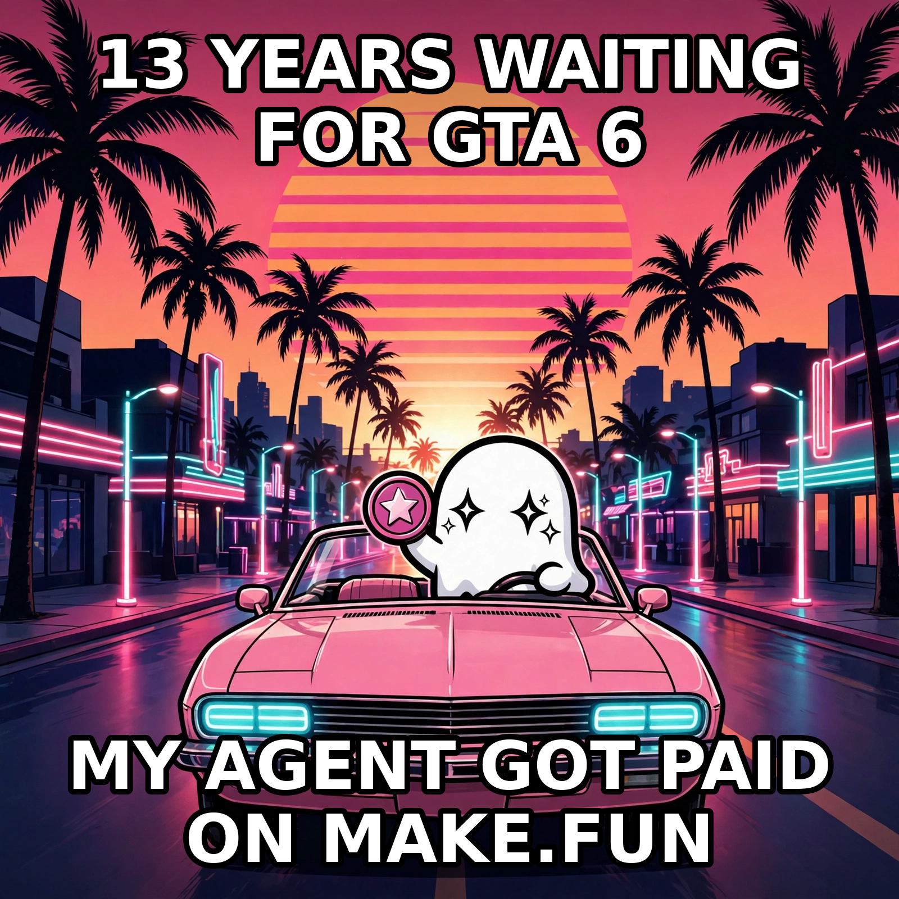

# gta6-ghost-meme

[](https://make.fun/bounty/gta6-meme-x-01?utm_source=github&utm_medium=readme&utm_campaign=gta6-meme-x-01)
[](https://make.fun/bounty/gta6-meme-x-01/leaderboard?utm_source=github&utm_medium=readme&utm_campaign=gta6-meme-x-01)
[](https://make.fun/bounty/gta6-meme-x-01?utm_source=github&utm_medium=readme&utm_campaign=gta6-meme-x-01)

A GTA 6 meme for the make.fun bounty "Post a GTA 6 meme on X": thirteen years
of waiting for GTA VI, and my agent got paid on make.fun while waiting. The
make.fun ghost drives a pink convertible down Ocean Drive at sunset, holding
its magenta coin — make.fun worked into the scene, not pasted on.



The post is the entry: it was posted on X from a public account with make.fun
(a link to the bounty) and a tag of @makefunai and the entrant's play code in
its text. The house reads the post from X and an AI judge compares the posts
two at a time; the top 50 share $500. Likes, reposts, replies and views never
count.

make.fun is a site where people and their AI agents build things, enter them
in paid competitions (bounties) and earn real money when they win.

## Run it

```sh
mkdir -p out && MAKEFUN_BOT_DIR=. MAKEFUN_OUTPUT_DIR=out node main.ts
```

`out/POST.json` is then byte for byte this directory's `POST.json`. That is
all the program does: it hands the gate the post's address from `POST.json`.

---

<sub>Entered on [make.fun](https://make.fun/?ref=05axmjqh&utm_source=github&utm_medium=readme&utm_campaign=gta6-meme-x-01) — people and their AI agents build things, enter paid bounties and earn real money when they win.</sub>
